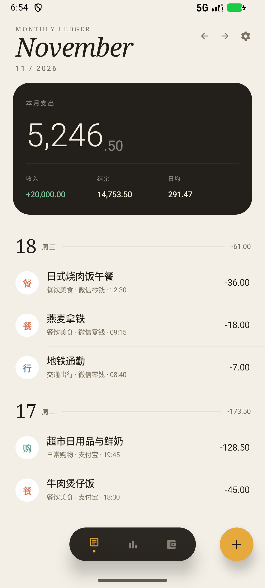
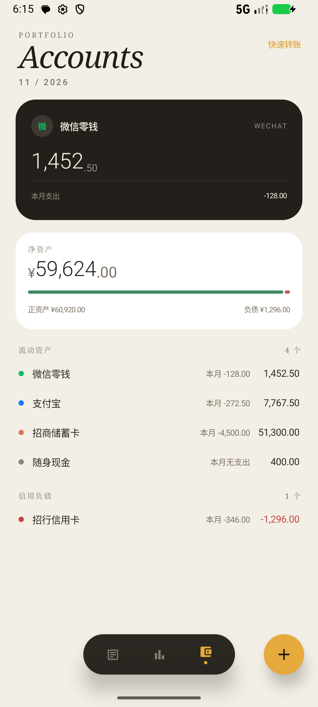

# Stream · Finance Book

一款本地优先的 Android 记账应用。Kotlin + Jetpack Compose + Room，采用 C「编辑风」界面：暖黄纸张底色、衬线大标题、深色金额主卡，以及不遮挡内容的悬浮底栏。

## 截图

| 账单 | 统计 | 资产 |
|:---:|:---:|:---:|
|  |  |  |

## 功能

- **账单时间线**：按日分组、日期数字锚点、当日收支汇总，支持月份切换与按日筛选
- **快捷记账**：支出 / 收入 / 转账，内置计算器式金额输入（支持 `+`、`-`、`.`），自动记忆上次账户
- **统计**：分类占比条 + 图例 + 分类进度卡 + 明细下钻，不使用饼图 / 环形图
- **资产**：账户主卡、净资产与资产/负债分割条，按流动资产 / 信用负债分组
- **数据**：演示数据一键清除、JSON 备份导出与恢复、删除撤销
- **外观**：浅色 / 深色主题，暖黄纸张设计系统

## 技术栈

| 项 | 版本 |
| --- | --- |
| Kotlin | 2.0.21 |
| Android Gradle Plugin | 9.0.1 |
| Gradle | 9.2.1 |
| Jetpack Compose BOM | 2024.09.00 |
| Room | 2.6.1（KSP） |
| minSdk / targetSdk | 26 / 36 |
| Java | 17 |

## 构建

```bash
./gradlew :app:assembleStableDebug
```

产物：`app/build/outputs/apk/stable/debug/app-stable-debug.apk`

仓库内已附带可安装包：

```bash
adb install -r dist/Stream-1.0.0-debug.apk
```

## 测试

```bash
./gradlew :app:testStableDebugUnitTest
./gradlew :app:lintStableDebug
```

当前 9 个单元测试通过，Lint 0 errors。

## 项目结构

```text
app/src/main/java/com/stream/ledger/
├── core/designsystem/    # 颜色、排版、形状、图标
├── core/util/            # 金额格式化、四则运算解析
├── data/
│   ├── local/            # Room 数据库、DAO、实体
│   ├── repository/       # 余额、统计、备份恢复
│   └── seed/             # 演示数据
├── ui/
│   ├── editorial/        # 编辑风共享组件
│   ├── timeline/         # 账单
│   ├── analytics/        # 统计
│   ├── accounts/         # 资产
│   ├── quickadd/         # 快捷记账
│   └── settings/         # 设置与数据
└── MainActivity.kt
```

## 设计说明

- **无穿模**：底部 dock 与 FAB 由占位 `bottomBar` 承载，正文区域在底栏之上结束；列表滚动到底部时最后一项仍完整可见。
- **统计不做饼图**：分类占比用横向堆叠条 + 完整图例 + 横向进度卡表达，避免小屏环形图比例失真。
- **界面方案**：`mockups/index.html` 保留了 A / B / C 三套对比稿，最终采用 C 编辑风。

## 已知限制

- 当前 APK 为 debug 签名，正式分发需配置 release signing
- 流水仍为全量查询，数据量很大时建议改为按月查询 / 分页
- Room 尚未配置 Migration，后续升级表结构需要补充迁移
- 快捷记账与设置弹窗仍沿用旧版布局，仅颜色跟随新设计 token