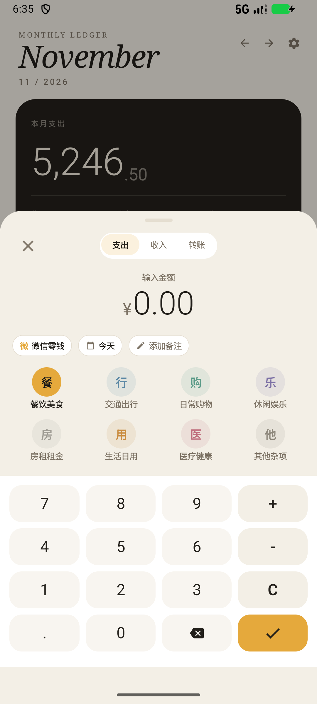
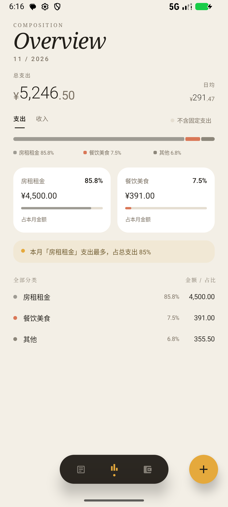

<div align="center">

# Stream · Finance Book

**一款克制、安静、本地优先的「编辑风」Android 记账应用**

*暖黄纸张底色 · 衬线斜体标题 · 深色金额主卡 · 磨砂玻璃悬浮底栏*

<p>
  
  
  
  
  
</p>

由 Jetpack Compose 完整迁移至 Flutter，所有账目全部保存在本机 SQLite，不申请 `INTERNET` 权限。

</div>

---

## 界面一览

<table>
  <tr>
    <td align="center" width="25%"><strong>账单时间线</strong></td>
    <td align="center" width="25%"><strong>快捷记账</strong></td>
    <td align="center" width="25%"><strong>收支统计</strong></td>
    <td align="center" width="25%"><strong>资产账户</strong></td>
  </tr>
  <tr>
    <td align="center"></td>
    <td align="center"></td>
    <td align="center"></td>
    <td align="center"></td>
  </tr>
</table>

---

## 设计哲学

- **C「编辑风」视觉系统**：借鉴纸质杂志与 Apple 备忘录的排版克制感——浅色模式采用暖黄纸张底色（`#F3EFE6`），深色模式采用碳素深灰（`#181715`），搭配衬线斜体大标题、深色金额主卡（`#231F1A`）与极细分割线（`0.5dp`）。
- **零网络纯本地隐私**：Android 清单不声明 `INTERNET` 权限；支持 6 位 PIN 应用锁（`PBKDF2-HMAC-SHA256` 加盐存储），冷启动先拦截校验再渲染主界面，切入后台自动重新上锁。
- **分毫级整数金融运算**：所有金额以「分（`int`）」存储和计算，内置四则运算输入解析器（支持 `+`、`-`、`.`），从源头杜绝 `0.1 + 0.2` 类浮点误差。
- **跟手而不遮挡的交互**：`208×56` 磨砂玻璃悬浮胶囊底栏配合 `SpringSimulation` 弹性指示器，支持页面横滑双向同步与底栏拖拽切页；`extendBody` 让列表从玻璃底栏背后自然滑过。

---

## 核心功能

| 模块 | 能力概览 |
| :--- | :--- |
| **账单时间线** | 按日分组与每日节奏柱状图（P85×2 封顶防单笔大额压扁全月）、月度总预算进度条、按日筛选、跨月全文搜索（备注 / 分类 / 账户 / 金额）、长按或右侧菜单编辑/软删除 |
| **快捷记账** | 支持支出 / 收入 / 转账，计算器键盘常驻可见；自动记忆上次使用账户，置顶分类优先展示，编辑已有账单可无损回填 |
| **收支统计** | 坚持不用小屏易失真的饼图/环形图，改用「横向堆叠占比条 + 图例 + 分类进度卡 + 明细下钻」；支持支出/收入切换、独立月份切换与「不含固定支出」过滤 |
| **资产账户** | 净资产 Hero 主卡与资产/负债分割条，按微信/支付宝/银行卡/信用卡/现金等类型分组，支持新增、编辑与安全归档保护 |
| **预算与周期记账** | 账单页常驻月度预算进度条；支持每月固定日期（1–28 日）自动补记流水，基于 `dedupKey` 幂等去重，删除后不会重复复活 |
| **分类与回收站** | 分类新增、改名、置顶与固定支出标记；默认分类与有关联流水（含回收站）的账户/分类受保护；软删除支持 4 秒撤销，回收站支持恢复（自动解除对应账户/分类归档）或彻底清除 |
| **导出与加密备份** | 导出带 UTF-8 BOM 的 CSV 表格（Excel 直接双击不乱码）；JSON 全量备份包含流水、账户、分类、预算与周期规则；支持口令加密备份（`PBKDF2-HMAC-SHA256` 100k 轮派生 + `AES-256-CBC` + `HMAC-SHA256` Encrypt-then-MAC，向下兼容 v1 加密备份） |
| **外观主题** | 支持「跟随系统 / 浅色纸张 / 深色碳素」三档实时切换并持久化保存 |

---

## 技术栈与架构

| 层次 | 选型与实现细节 |
| :--- | :--- |
| **框架与语言** | Flutter `3.47.9`（stable） / Dart `3.13.7` |
| **主题与设计 Token** | Material 3 `ThemeData` + `ThemeExtension`（`StreamPalette`、`StreamShapes`、`StreamEditorialType`） |
| **状态与性能隔离** | `AppState`（`ChangeNotifier` + `AppScope`）集中管理业务状态；切页进度走 `ValueNotifier<double>` + `RepaintBoundary`，横滑仅重绘底栏；时间线采用 `CustomScrollView` + `SliverList` 惰性渲染 |
| **本地持久化** | `sqflite` 2.4 + 手写 DDL 与 `v1 → v2` 迁移，开启 `PRAGMA foreign_keys = ON` 保证引用完整性 |
| **安全与导出** | `crypto` 3 + `encrypt` 5（`PBKDF2-HMAC-SHA256` + `AES-256-CBC` + `HMAC-SHA256`）、`share_plus` 10、`file_picker` 10.3.3、`path_provider` 2 |
| **工程质量与 CI** | `flutter_lints` + `sqflite_common_ffi` 内存 SQLite 集成测试；GitHub Actions（`.github/workflows/flutter.yml`）在 push / PR 时自动执行 `analyze + test + build` |

<details>
<summary><strong>目录结构与设计参数细节</strong>（点击展开）</summary>

```text
lib/
├── core/
│   ├── money.dart                  # 分单位整数格式化与四则运算表达式解析器
│   └── pbkdf2.dart                 # RFC 2898 PBKDF2-HMAC-SHA256 与常量时间比对
├── data/
│   ├── models.dart                 # Account / Category / LedgerTransaction / Budget / RecurringRule
│   ├── ledger_database.dart        # SQLite 建库、外键约束与 v2 迁移（支持测试注入）
│   ├── ledger_repository.dart      # 事务级 CRUD、软删除恢复、全量 JSON 备份与还原
│   ├── calculators.dart            # 余额、净资产、月度节奏柱状图、分类占比纯函数计算
│   ├── export_service.dart         # CSV (UTF-8 BOM) 与 v2 加密备份 (PBKDF2 + Encrypt-then-MAC)
│   └── seed.dart                   # 默认分类与首个「现金」账户（无演示脏数据）
├── design/                         # 色彩 token、排版、圆角、图标与 ThemeExtension
├── widgets/editorial.dart          # 编辑风通用组件与 208×56 磨砂玻璃悬浮底栏
├── ui/                             # 账单 / 统计 / 资产三屏及记账、设置、预算、周期、回收站、应用锁面板
├── app_state.dart                  # 全局状态、周期补记、PIN 认证与主题持久化
├── app.dart                        # MaterialApp 入口
└── main.dart                       # 冷启动先完成初始化再挂载 UI
test/                               # 54 项单元、内存 SQLite 仓库与 Widget 集成测试
android/                            # Flutter Android 宿主工程（com.stream.ledger）
mockups/                            # A / B / C 三套对比设计稿与实机截图
```

- **玻璃底栏参数**：`208×56` 胶囊容器，`ClipRRect` + `BackdropFilter(sigma: 14)` 局部磨砂、1dp 白色 20% 高光描边。
- **指示器动效**：`56×52` `StadiumBorder` 药丸，切换采用 `SpringSimulation(stiffness: 320, damping: 30)`（带 `≤ 2dp` 过冲），按住拖动按速度拉伸至多 `6dp`，松手按「页码 + 速度 / 3200」吸附最近页。
- **安全区域**：正文由 `SafeArea` 避让状态栏，三屏底部统一预留 `114dp`（`90dp` 底栏 + `24dp` 余量），保证最后一条记录完整滚出且可点击。

</details>

---

## 安装与构建

### 直接安装预编译 APK

可从本仓库的 [GitHub Releases](https://github.com/LabourHour/Finance-Book/releases) 下载对应版本的 `Stream-*-flutter.apk`，或使用仓库内附带的签名安装包 [`dist/Stream-1.0.0-flutter.apk`](dist/Stream-1.0.0-flutter.apk)（`applicationId: com.stream.ledger`）：

```bash
adb install -r dist/Stream-1.0.0-flutter.apk
```

> **签名变更提示**：若此前安装过早期 debug 签名版本，因签名密钥不同**无法直接覆盖安装**。请先在旧版「设置 → 导出 JSON 备份」，卸载旧版后安装新版并在设置中恢复备份。

### 从源码构建与测试

需要 Flutter SDK（`3.47+`）与 Android SDK（本机示例路径 `C:\flutter`）：

```bash
# 安装依赖
flutter pub get

# 静态检查与全部 54 项测试
dart analyze
flutter test

# 构建 release APK（输出至 build/app/outputs/flutter-apk/app-release.apk）
flutter build apk --release
```

> **Release 签名说明**：构建脚本会自动读取未提交的 `android/key.properties` 与 `android/app/stream-release.jks`；在 CI 或新克隆环境中缺失上述文件时，会自动回退至 debug 签名以确保构建通过。

---

## 已知限制

- 启动时一次性加载全部有效流水并在内存计算统计结果（列表已使用 Sliver 惰性渲染）；若账目达到数万条规模，建议演进为按月/分页 SQL 聚合。
- 回收站中的软删除账单会长期保留（不参与统计与导出），需在回收站中手动彻底删除。
- 周期记账当前仅支持「每月固定日期（1–28 日）」一种周期频率。
- 应用锁与加密备份均为纯本地密码学保护，若遗忘 PIN 需卸载重装（数据可通过备份恢复），若遗忘加密备份口令则无法解密恢复。
